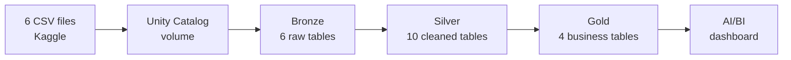

# Olist Lakehouse on Databricks

An end-to-end data pipeline on Databricks that turns ~100,000 raw e-commerce orders
into trusted, business-ready tables and a dashboard, built to answer one question:
**do customers come back?**


## The answer

- **97% of customers buy only once.** Of 93,358 customers with a delivered order, only 2,801 returned.
- **Revenue is concentrated.** São Paulo alone brings in 37.4% of R$15.4M revenue; the top three states, 62.5%.
- **Delivery is a hidden strength.** 93.2% of orders arrive on time, in 12.5 days against a promised 24.4.

Converting just 5% of one-time buyers into repeat customers would add about **R$724K**
without acquiring anyone new. Full write-up: [project brief](analytics_briefs/retention_analysis_brief.md).

## Architecture



The pipeline is a **Lakeflow Declarative Pipeline** written in SQL. Each file declares what its
tables should contain, and Databricks works out the build order from the dependencies.

| Layer | What it does | Key tables |
|-------|--------------|------------|
| **Bronze** | Loads the CSVs as-is, plus the source file name and load time for every row | `orders`, `customers`, `order_payments`, … |
| **Silver** | Converts types (dates, `DECIMAL` money), tidies text, removes bad rows, joins orders to customers, payments and products | `stg_*`, `int_orders_enriched`, `int_monthly_orders` |
| **Gold** | Business-ready facts and dimensions | `fact_orders`, `fact_monthly_revenue`, `dim_customers`, `dim_products` |

## Data quality

Checks run inside the pipeline on every run, using expectations at three levels:

| Level | What happens | Example |
|-------|--------------|---------|
| **Stop** | The run fails, so bad data never reaches reports | Every order has an ID; order status is a known value |
| **Drop** | Bad rows are removed and counted | Zero-value payments (9 rows) |
| **Flag** | Rows are kept, the issue is recorded | Orders delivered before they were placed |

Every table is also checked for duplicate primary keys. [`sql/01_validation.sql`](sql/01_validation.sql)
lists each check with its expected result.

## Design decisions

- **Customers are counted by `customer_unique_id`.** Olist gives every order a new `customer_id`,
  so counting that would make every customer look like a one-time buyer. `dim_customers` has
  one row per real person.
- **Money is stored as `DECIMAL(10,2)`,** not floating point, so totals don't drift.
- **Primary payment type** is the method that paid the largest amount (`max_by`), not the
  alphabetically last one.
- **"Days since last order"** is measured from the last date in the data (2018), not from today.

## Repository structure

```
pipelines/
  01_bronze.sql              raw ingestion from the volume (streaming tables)
  02_silver.sql              cleaning, joins and expectations (materialized views)
  03_gold.sql                facts, dimensions and key checks
sql/
  00_setup.sql               schemas and volume (run once)
  01_validation.sql          checks with expected results
  02_dashboard_queries.sql   datasets behind the dashboard
analytics_briefs/            project brief
images/                      dashboard screenshot
```

## How to run it

1. Sign up for [Databricks Free Edition](https://www.databricks.com/learn/free-edition).
2. Run `sql/00_setup.sql` in the SQL editor.
3. Download the [Olist dataset](https://www.kaggle.com/datasets/olistbr/brazilian-ecommerce) and
   upload 6 CSVs (orders, customers, order_items, order_payments, products, sellers), each into
   its own folder under `/Volumes/workspace/raw/olist/`.
4. Add this repo as a Git folder, then create an ETL pipeline with `pipelines/` as its source
   folder and `workspace` as its default catalog.
5. Run the pipeline, then run `sql/01_validation.sql` and compare with the expected results.
6. Build the dashboard from the queries in `sql/02_dashboard_queries.sql`.

## Next steps

- **CI/CD:** Databricks Asset Bundles + GitHub Actions to validate, deploy and run the pipeline on every push.
- **Genie:** a natural-language space over the gold tables, tested against a set of benchmark questions.

## Tools

Databricks Free Edition · Unity Catalog · Lakeflow Declarative Pipelines (SQL) · AI/BI Dashboards · GitHub

## Author

Supratim Narzary · [GitHub](https://github.com/supratimnarzary)
